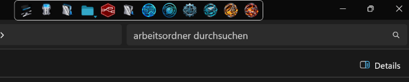
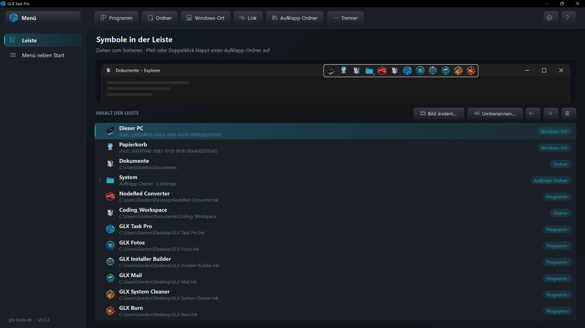
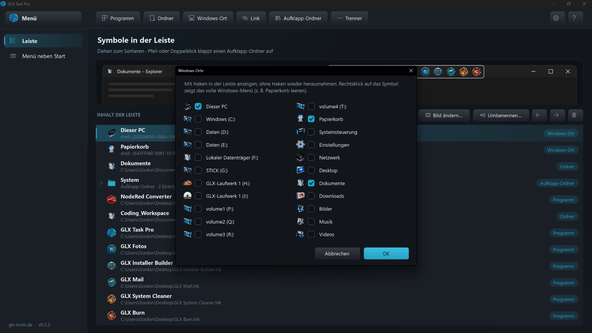
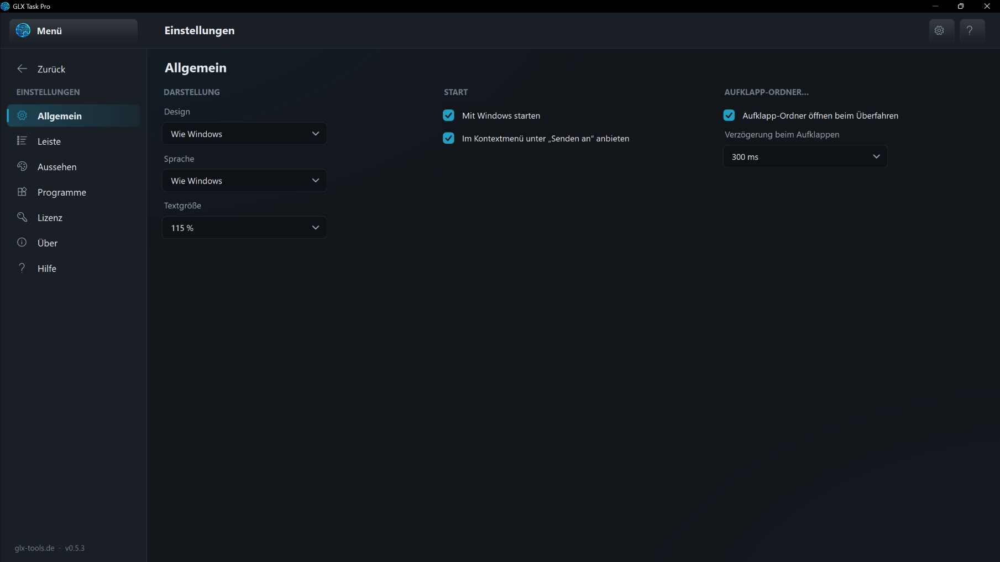
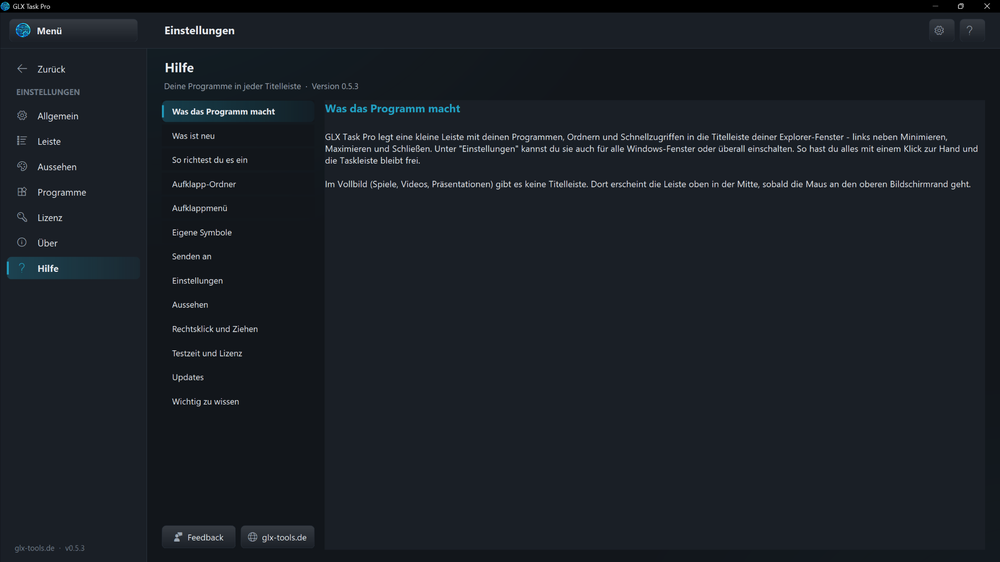

🌍 Sprachen: [🇺🇸 English](README.md) | [🇩🇪 Deutsch](README.de.md)

# 💠 GLX Task Pro

### Deine Programme in jeder Titelleiste.

*GLX Task Pro setzt eine kleine Startleiste mit deinen Programmen, Ordnern und Verknüpfungen direkt in die Titelleiste deiner Explorer-Fenster, gleich neben Minimieren, Maximieren und Schließen. Alles ist nur einen Klick entfernt, und deine Taskleiste bleibt aufgeräumt.* ⚡

   

---

## ⬇️ Download

👉 Neueste Version: [Releases](../../releases/latest)  
👉 Shop und Lizenzen: [glx-tools.de](https://glx-tools.de/product/glx-task-pro/)

---

## 📖 Über GLX Task Pro

### Deine Programme in jeder Titelleiste

GLX Task Pro setzt eine kleine Startleiste mit deinen Programmen, Ordnern und Verknüpfungen direkt in die Titelleiste deiner Explorer-Fenster, neben Minimieren, Maximieren und Schließen. Auf Wunsch erscheint sie an allen Fenstern oder überall. In Vollbild-Programmen wie Spielen, Videos oder Präsentationen fährt sie oben am Bildschirmrand herein, sobald die Maus ihn berührt.

### Ordner, Menüs und Windows-Orte

Aufklapp-Ordner öffnen sich wie Stapel und halten die Leiste kurz. Neben dem Start-Button sitzt ein zweispaltiges Aufklappmenü mit Listen- oder Kachelansicht und Effekten wie Ausrollen, Verpixeln oder Kristallisieren. Dieser PC, Laufwerke, Papierkorb und deine Benutzerordner kommen mit einem Haken dazu und zeigen das echte Windows-Kontextmenü.

### Ziehen, ablegen, senden

Ziehe Dateien aus dem Explorer direkt auf die Leiste oder in einen Aufklapp-Ordner, oder wähle per Rechtsklick Senden an > GLX Task Pro. Symbole wählst du aus den eingebauten Sammlungen Modern und Retro oder aus eigenen Ordnern.

### Dein Aussehen

13 Designs von GLX Neon bis Hell, oder automatisch wie Windows. Zoom beim Überfahren, eigene Farben, Transparenz und Schriftgröße bis 175 %, Deutsch und Englisch.

### Sicher und geprüft

GLX Task Pro verändert keine anderen Programme. Updates werden im Programm angekündigt und erst nach einer signierten Prüfsummen-Kontrolle installiert. 7 Tage kostenlos testen, danach mit Lizenz freischalten.

---

## 📸 Überblick & Screenshots

### 1️⃣ Die Leiste in der Titelleiste des Explorers

### 2️⃣ Symbole der Leiste anordnen

### 3️⃣ Windows-Orte mit einem Haken hinzufügen

### 4️⃣ Allgemeine Einstellungen

### 5️⃣ Integrierte Hilfe

---

## ✨ Funktionen

- 🚀 **Startleiste in der Titelleiste:** Deine Programme, Ordner und Verknüpfungen sitzen direkt neben Minimieren, Maximieren und Schließen jedes Explorer-Fensters. Auf Wunsch auf allen Fenstern oder überall.
- 🧩 **Funktioniert auch im Vollbild:** Spiele, Videos und Präsentationen haben keine Titelleiste, deshalb fährt die Leiste oben in der Mitte herein, sobald die Maus den Bildschirmrand berührt.
- ⚙️ **Aufklappbare Ordner:** Ein Symbol öffnet ein ganzes Menü wie ein Stapel. Befülle es per Drag & Drop und halte die Leiste kurz und ordentlich.
- 🔒 **Pop-up-Menü neben Start:** Ein zweispaltiges Menü in der Taskleiste mit Listen- oder Kachelansicht, eigenen Symbol- und Textgrößen und fünf Öffnungseffekten: Ausrollen, Verpixeln, Kristallisieren, Gleiten und Zufall.
- 📂 **Windows-Orte mit vollem Kontextmenü:** Dieser PC, jedes Laufwerk, der Papierkorb und deine Benutzerordner mit einem Haken hinzufügen. Ein Rechtsklick zeigt das echte Windows-Menü, zum Beispiel Papierkorb leeren oder Formatieren.
- ⚡ **Drag & Drop überall:** Dateien aus dem Explorer auf die Leiste oder in einen aufklappbaren Ordner ziehen, Dateien auf das Papierkorb-Symbol werfen, die Leiste mit Trennern gliedern und gegen versehentliche Änderungen sperren.
- 🎨 **Symbolauswahl mit Sammlungen:** Wähle aus den eingebauten Sammlungen Modern und Retro oder füge eigene Ordner mit ico-, png-, jpg-, dll- oder icl-Dateien hinzu. Eine Sicherheitskopie sorgt dafür, dass kein Symbol verloren geht.
- 🌍 **Senden an GLX Task Pro:** Rechtsklick auf eine Datei, ein Programm oder einen Ordner, dann Senden an > GLX Task Pro, und schon liegt es auf der Leiste.
- 🛠️ **13 Designs und volle Gestaltung:** GLX Neon, Dunkel, Hell, Ozean, Sonnenuntergang und mehr, oder automatisch wie Windows. Vergrößern beim Überfahren, eigene Farben, Transparenz, Rahmen und Textgröße von 85 % bis 175 %.
- 📊 **Sichere automatische Updates:** Neue Versionen werden im Programm angekündigt und erst nach einer signierten Prüfsummenkontrolle installiert. Eine Datei mit falscher Prüfsumme wird nie gestartet. Deutsch und Englisch.

---

## 🧩 Systemanforderungen

- Windows 10 oder Windows 11 (64-Bit)
- .NET Framework 4.8 (in Windows 10/11 enthalten)

---

## 🧪 Testzeitraum & Lizenz

7 Tage ohne Einschränkungen kostenlos testen. Danach wird nur die Leiste ausgeblendet; deine Einträge, Symbole und Einstellungen bleiben erhalten. Eine Lizenz gibt es auf [glx-tools.de](https://glx-tools.de).

---

## 🔐 Datenschutz

GLX Task Pro verändert keine anderen Programme. Es liest nur, wo deren Fenster liegen, und legt seine eigene kleine Leiste darüber. Programme, die du über die Leiste startest, laufen mit deinen normalen Benutzerrechten. Die Einstellungen liegen in `%APPDATA%\GLX Task Pro`.

---

## 🔗 Mehr zu diesem Produkt

👉 [glx-tools.de](https://glx-tools.de/product/glx-task-pro/)  
Support: **info@glx-tools.de**

---

## 📄 Lizenz

Copyright © 2026 GLX Tools – Gordon Lehmann. Alle Rechte vorbehalten.  
Dies ist proprietäre kommerzielle Software. Es wird keine Open-Source-Lizenz gewährt. Dieses Repository enthält nur Release-Downloads und Dokumentation; der Quelltext wird nicht veröffentlicht.

---

Mit ❤️ gemacht von **Dreamdancer100**

