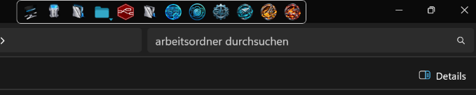
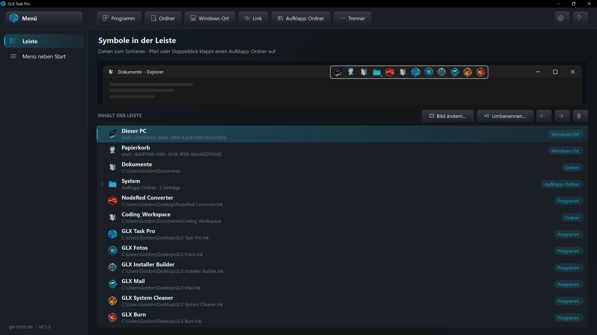
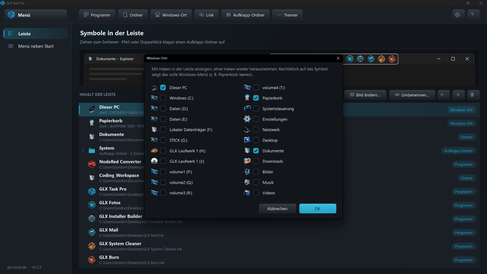
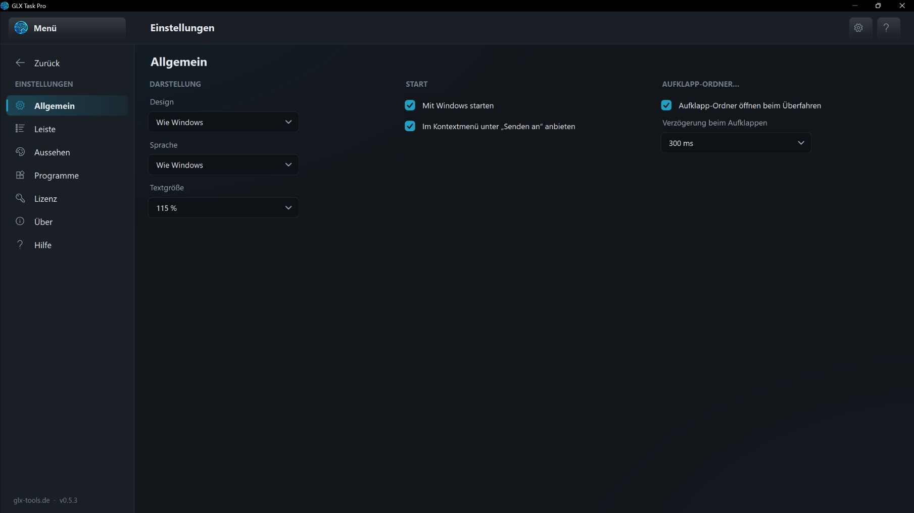
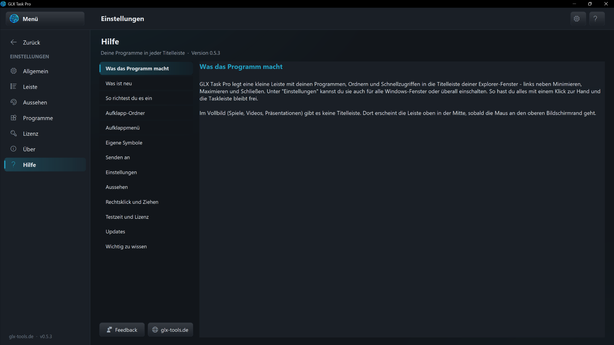

🌍 Languages: [🇺🇸 English](README.md) | [🇩🇪 Deutsch](README.de.md)

# 💠 GLX Task Pro

### Your programs in every title bar.

*GLX Task Pro puts a small launcher bar with your programs, folders and shortcuts into the title bar of your File Explorer windows, right next to Minimize, Maximize and Close. Everything is one click away and your taskbar stays clean.* ⚡

   

---

## ⬇️ Download

👉 Latest version: [Releases](../../releases/latest)  
👉 Shop and licences: [glx-tools.de](https://glx-tools.de/product/glx-task-pro/)

---

## 📖 About GLX Task Pro

### Your programs in every title bar

GLX Task Pro puts a small launcher bar with your programs, folders and shortcuts right into the title bar of your File Explorer windows, next to Minimize, Maximize and Close. If you like, it appears on all windows or everywhere. In full-screen programs such as games, videos or presentations it slides in at the top edge of the screen as soon as the mouse touches it.

### Folders, menus and Windows places

Drop-down folders open like stacks and keep the bar short. A two-column pop-up menu sits next to the Start button, with list or tile view and opening effects such as Roll out, Pixelate or Crystallize. This PC, drives, the Recycle Bin and your user folders are added with one tick and show the real Windows right-click menu.

### Drag, drop and send

Drag files from File Explorer straight onto the bar or into a drop-down folder, or right-click any file and choose Send to > GLX Task Pro. Pick icons from the built-in Modern and Retro collections or from your own folders.

### Your look

13 themes from GLX Neon to Light, or follow Windows automatically. Zoom on hover, your own colours, transparency and text size up to 175 %, German and English.

### Safe and tested

GLX Task Pro never modifies other programs. Updates are announced in the program and installed only after a signed checksum check. Try it free for 7 days, then unlock it with a licence.

---

## 📸 Overview & Screenshots

### 1️⃣ The bar in the Explorer title bar

### 2️⃣ Arrange the symbols of your bar

### 3️⃣ Add Windows locations with one tick

### 4️⃣ General settings

### 5️⃣ Built-in help

---

## ✨ Features

- 🚀 **Launcher bar in the title bar:** Your programs, folders and shortcuts sit right next to Minimize, Maximize and Close of every File Explorer window. Optionally on all windows or everywhere.
- 🧩 **Works in full screen too:** Games, videos and presentations have no title bar, so the bar slides in at the top centre as soon as the mouse touches the screen edge.
- ⚙️ **Drop-down folders:** One icon opens a whole menu like a stack. Fill it by drag and drop and keep the bar short and tidy.
- 🔒 **Pop-up menu next to Start:** A two-column menu sits on the taskbar with list or tile view, own icon and text sizes and five opening effects: Roll out, Pixelate, Crystallize, Glide and Random.
- 📂 **Windows places with full context menu:** Add This PC, every drive, the Recycle Bin and your user folders with one tick. A right-click shows the real Windows menu, e.g. Empty Recycle Bin or Format.
- ⚡ **Drag and drop everywhere:** Drag files from File Explorer onto the bar or into a drop-down folder, drop files on the Recycle Bin icon, split the bar with separators and lock it against accidental changes.
- 🎨 **Icon picker with collections:** Choose from the built-in Modern and Retro collections or add your own folders with ico, png, jpg, dll or icl files. A safe copy is kept so no icon ever gets lost.
- 🌍 **Send to GLX Task Pro:** Right-click any file, program or folder and choose Send to > GLX Task Pro to put it on the bar instantly.
- 🛠️ **13 themes and full styling:** GLX Neon, Dark, Light, Ocean, Sunset and more, or follow Windows automatically. Zoom on hover, own colours, transparency, borders and text size from 85 % to 175 %.
- 📊 **Safe automatic updates:** New versions are announced in the program and installed only after a signed checksum check. A file with a wrong checksum is never started. German and English.

---

## 🧩 Requirements

- Windows 10 or Windows 11 (64-bit)
- .NET Framework 4.8 (included in Windows 10/11)

---

## 🧪 Trial & License

Free to try without limits for 7 days. After that only the bar switches off; your entries, icons and settings are kept. A licence is available at [glx-tools.de](https://glx-tools.de).

---

## 🔐 Privacy

GLX Task Pro does not modify other programs. It only reads where their windows are and places its own small window on top. Programs started from the bar run with your normal user rights. Settings are stored in `%APPDATA%\GLX Task Pro`.

---

## 🔗 More about this product

👉 [glx-tools.de](https://glx-tools.de/product/glx-task-pro/)  
For support: **info@glx-tools.de**

---

## 📄 License

Copyright © 2026 GLX Tools – Gordon Lehmann. All rights reserved.  
This is proprietary commercial software. No open-source license is granted. This repository contains release downloads and documentation only; the source code is not published.

---

Made with ❤️ by **Dreamdancer100**

